# Gram

A desktop app where an orchestrator agent runs a team of coding agents for you. You give it
tasks; it hands them to Claude Code and Codex workers, each in its own git worktree, and follows
them through to merged pull requests.

## Why?

I kept ending up with five to ten Claude Code sessions open at once, and keeping track of what each was
doing, what it was waiting on and what came next was the hard part. That kind of bookkeeping is not
something my brain is good at and is not fun, but an agent is good at tracking these things. So Gram gives the tracking to an orchestrator
agent, in a setup similar in spirit to Claude Tag.

It is deliberately unopinionated about how you work. The same pieces run as a swarm, with many
workers in parallel messaging each other, or as agents-as-tools, with the orchestrator calling on
a worker for one specific job.

## How it works

<picture>
  <source media="(prefers-color-scheme: dark)" srcset="docs/images/how-it-works-dark.svg">
  
</picture>

The orchestrator writes a brief for each piece of work and spawns a worker on it. Workers report
back, ask questions and open pull requests; the orchestrator answers what it can and passes the
rest to you. Between turns, every agent sleeps until an event wakes it.

The orchestrator is meant to be a long-lived thread: you keep one per workspace and come back to it, rather than starting a fresh chat for each task. It is where you talk through priorities and plans, and where results, blockers and decisions come back to you. Its memory and the digests it gets from workers carry it across sessions, so it picks up where it left off.

- **Woken by events, not polling.** The thread that cares wakes when CI checks settle, a review
  lands, a pull request merges, a dependency's pull request moves, or a time it set comes round.
- **Hands-off or hands-on.** Let it plan and merge on its own, or open any worker's thread to
  read, steer or answer it.
- **Memory.** The orchestrator remembers your goals, decisions and standing rulings across
  sessions.
- **Messaging.** Orchestrator and workers talk both ways, and workers can message each other.
- **Workers for different jobs.** Mix harnesses and models by assignment: send reviews to Codex,
  keep implementation on Claude, and give specialised work such as reverse engineering to mythos.

## Install

Download the latest build from [GitHub Releases](https://github.com/ANT1OFF/gram/releases),
unzip it and move `Gram.app` to Applications
([checksum and update steps](docs/UPDATES.md#installing-a-release)).

You need macOS on Apple silicon, plus Claude Code and/or the Codex CLI installed and signed in
(`claude /login`, `codex login`), and a signed-in GitHub CLI (`gh`) for pull requests. Gram runs
on your own subscriptions; no API key is needed.

## Develop

```sh
bun install --frozen-lockfile
bun run check:scaffold
bun run dev:desktop
```

See [development](docs/DEVELOPMENT.md) for prerequisites and every run and check command.

## Docs

- [Agents and features](docs/AGENTS_AND_FEATURES.md)
- [Architecture](docs/ARCHITECTURE.md)
- [Development](docs/DEVELOPMENT.md) and [testing](docs/VERIFICATION.md)
- [Updates](docs/UPDATES.md) and [releasing](docs/RELEASING.md)
- [Contributing](CONTRIBUTING.md)
- [Design notes](DESIGN.md)

The [docs map](docs/README.md) lists every page and what it covers.

## License

[MIT](LICENSE). Bundled dependencies keep their own licenses; see
[packaged dependency notices](docs/DEVELOPMENT.md#packaging-and-dependency-notices).
