# Gram

[](https://github.com/ANT1OFF/gram/releases/latest)
[](https://github.com/ANT1OFF/gram/actions/workflows/check.yml)
[](LICENSE)

A desktop app for macOS and Linux where an orchestrator agent runs a team of Claude Code and Codex
workers for you, each in its own git worktree, from task to merged pull request.

![Gram on a workspace's orchestrator. The sidebar has a 1 question pill, then the storefront workspace and its four workers: Order email asks you, Cart summary is working, Address picker has pull request #142 with checks passed and review to come, and Typo tolerance has #424 with checks running; then a few solo threads. The title bar holds Chat and Board, Fresh session and the orchestrator's Memory, with the usage button on the right. In the chat, the task given to the orchestrator, its reply that it started six workers, and a card per feature with each worker's state and pull request, two of them merged.](docs/assets/gram-orchestrator.png)

- **An orchestrator per workspace.** You give it tasks; it writes a brief for each, starts a
  worker on it and answers what it can, passing the rest to you. New task (⌘N) goes either to an
  orchestrator, which decides how to run it, or to a chat with one agent (⌘T).
- **Isolated workers.** Each worker is a normal Claude Code or Codex thread in its own worktree
  and branch, so your checkout stays as it was. Open any of them beside the orchestrator's chat
  to read, steer or answer it.
- **Woken by events, not polling.** The thread that cares wakes when CI settles, a review lands,
  a pull request merges or a time it set comes round.
- **Autonomy you choose.** Supervised asks before anything leaves your machine, Publish (the
  default) pushes and opens pull requests, and Full also merges on its own. New task shows the
  workspace's merge approval beside Start, Ask or Automatic, so you can change it as you start.
- **One Inbox for what needs you.** Questions, approvals, plans, reviews and failures from every
  workspace collect in one list (⌘⇧I), docked beside your work and each answered in place.

## Requirements

- macOS on Apple silicon, or Linux on x64 (the AppImage, or the .deb for Debian 12, Ubuntu 24.04
  and later). On Linux, gateway keys need a desktop keyring (GNOME Keyring or another Secret
  Service, or KWallet), and voice dictation uses the system's default input through PipeWire or
  PulseAudio.
- [Claude Code](https://docs.claude.com/en/docs/claude-code/overview) and/or the
  [Codex CLI](https://github.com/openai/codex), installed and signed in (`claude /login`,
  `codex login`). Gram runs them on your own subscriptions; no API key is needed.
- Git 2.31 or newer. Gram refuses to run an older git, which can't take the settings Gram uses to
  stop a repository's own git config from running programs.
- Optional: xAI's Grok Build CLI (`grok login`) for chat threads on your Grok subscription.
- Optional: Google's Antigravity CLI (`agy`, signed in) for chat threads on your Google AI plan.
- Optional: the [GitHub CLI](https://cli.github.com) (`gh auth login`) for pull requests, checks
  and merges.

## Install

Download from the [latest release](https://github.com/ANT1OFF/gram/releases/latest):

- **macOS:** `gram_<version>_darwin-arm64_signed.zip`. Unzip it and move `Gram.app` to
  Applications. It is Developer ID signed and notarized.
- **Linux AppImage:** `gram_<version>_x86_64.AppImage`. Make it executable and run it:
  `chmod +x gram_<version>_x86_64.AppImage && ./gram_<version>_x86_64.AppImage`. It needs FUSE 2
  (`libfuse2t64` on Ubuntu 24.04) and updates itself from Settings → About.
- **Linux .deb:** `sudo apt install ./gram_<version>_amd64.deb`. Settings → About says when a
  new release is out; install it the same way.

[Updates](docs/UPDATES.md#installing-a-release) covers checking the download against
`SHA256SUMS.txt` and its build attestation, and how Gram updates itself.

## Build from source

```sh
bun install --frozen-lockfile
bun run dev:desktop
```

[Development](docs/DEVELOPMENT.md) has the toolchain versions, every run and check command, and
packaging.

## Why

I kept ending up with five to ten Claude Code sessions open at once, and the hard part was keeping
track of what each was doing, what it was waiting on and what came next. That bookkeeping is
something an agent is good at, so Gram hands it to an orchestrator agent.

## How it works

<picture>
  <source media="(prefers-color-scheme: dark)" srcset="docs/images/how-it-works-dark.svg">
  
</picture>

A workspace is one or more repositories with one long-lived orchestrator thread. You keep coming
back to it rather than starting a fresh chat per task: it is where you talk through priorities,
and where results, blockers and questions come back to you. Its memory of your decisions and
standing rulings, and the digests it gets from workers, carry it across sessions; the brain beside
its title opens that memory to read or edit.

- **Discover.** A new workspace starts by surveying its repositories, remembering what it finds
  and suggesting a few starting tasks. Only the ones you tick start.
- **Messaging.** Orchestrator and workers talk both ways, and workers can message each other.
- **Models by assignment.** Each workspace lists the models its workers may use, with a note on
  what each is for: for example, implementation on Claude, independent reviews on Codex, and
  specialised work on a model you pick for it.
- **Routines.** A brief that comes due every day, on weekdays, weekly at a time like 09:00 or
  every few hours, and starts a worker or goes to the orchestrator. Settings → Routines lists
  them; routines run only while Gram is open.
- **Usage.** The title bar's usage button shows how close you are to your Claude Code and Codex
  limits. Settings → Usage has each limit with its reset time and your pace, Codex credits, and
  the last 7 or 30 days.
- **The Board.** Each feature's workers and pull requests on one line, from briefed to merged.

![Gram's Board as a grid with the columns Task, Stage, Now and Pull request. Three features are rows: Order email needs you, its template drafted; saved-addresses heads its three workers, Cart summary working, Address picker in review on #142 and Addresses API merged as #418; search-typos heads Typo tolerance waiting on checks for #424 and Search suggestions merged as #421. Each row's stage is a bar from briefed to merged, with the stage named under it. The title bar reads 1 waiting · Open Inbox, beside Hide finished.](docs/assets/gram-board.png)

The Inbox opens over your work, so you can answer without leaving your place.


Gram doesn't prescribe a way of working. The same pieces run as a swarm of workers in parallel
that message each other, or with the orchestrator calling on one worker for one job.
[Agents and features](docs/AGENTS_AND_FEATURES.md) covers it in depth.

## A closer look

Open a worker beside the orchestrator's chat (⌘\\) to read its transcript and pull request and to
steer it, without leaving the orchestrator.

![Gram with the orchestrator's chat on the left and the worker Search in Settings open beside it on the right. The chat has merged pull requests, an update from the worker, and the orchestrator's note that #142 waits on checks. The worker's side shows the end of its finished turn: what it changed in three files, 48 tests passed, 3 files changed with Undo and View changes, then "Looks right. Open the PR." and its reply that it opened #142 and fixed the review bot's two nits. Under it, #142's bar waiting on checks and a composer that reads Steer this thread.](docs/assets/gram-beside.png)

A message sent into a running turn steers it after the current tool call (↵). The chevron beside
Steer queues it for the end of the turn instead (⌥↵), or interrupts the turn (⌘.).


New task (⌘N) asks what needs doing, where it runs and who does it: a team, where the workspace's
orchestrator plans it, or a chat with one agent. The workspace's merge approval sits beside Send.


Settings → Appearance has nine palettes, each with a light and a dark version, and an editor for
your own colours.


## Focus

Watching a wall of agents work is a constant dopamine drip: something is always moving, and it
pulls your attention all day. Focus hides all of that and shows only what needs you, one card at a
time, with a dot per worker along the bottom. Get on with your own work and come back when you're
asked. Open it from View in the title bar's … menu or with ⌘⌥4 (Ctrl+Alt+4 on Linux), and leave
with Esc; **Focus when idle** in Settings → Notifications turns it on after five idle minutes with
nothing asked.


## Docs

- [Agents and features](docs/AGENTS_AND_FEATURES.md)
- [Architecture](docs/ARCHITECTURE.md)
- [Development](docs/DEVELOPMENT.md) and [testing](docs/VERIFICATION.md)
- [Updates](docs/UPDATES.md) and [releasing](docs/RELEASING.md)
- [Design notes](DESIGN.md)

The [docs map](docs/README.md) lists every page and what it covers.

## Contributing and security

[Contributing](CONTRIBUTING.md) covers branches, checks and pull requests. Report vulnerabilities
privately as described in the [security policy](SECURITY.md).

## License

[MIT](LICENSE). Bundled dependencies keep their own licenses; see
[packaged dependency notices](docs/DEVELOPMENT.md#packaging-and-dependency-notices).
