# Gram

[](https://github.com/ANT1OFF/gram/releases/latest)
[](https://github.com/ANT1OFF/gram/actions/workflows/check.yml)
[](LICENSE)

A macOS app where an orchestrator agent runs a team of Claude Code and Codex workers for you, each
in its own git worktree, from task to merged pull request.


- **An orchestrator per workspace.** You give it tasks; it writes a brief for each, starts a
  worker on it and answers what it can, passing the rest to you.
- **Isolated workers.** Each worker is a normal Claude Code or Codex thread in its own worktree
  and branch, so your checkout stays as it was. Open any of them to read, steer or answer it.
- **Woken by events, not polling.** The thread that cares wakes when CI settles, a review lands,
  a pull request merges or a time it set comes round.
- **Autonomy you choose.** Supervised asks before anything leaves your machine, Publish pushes
  and opens pull requests, and Full also merges on its own.
- **One Inbox for what needs you.** Questions, approvals, plans, reviews and failures from every
  workspace collect in one list, each answered beside it.

## Requirements

- macOS on Apple silicon, or Linux on x64 (the AppImage, or the .deb for Debian 12, Ubuntu 24.04
  and later). On Linux, gateway keys need a desktop keyring (GNOME Keyring or another Secret
  Service, or KWallet), and voice dictation uses the system's default input through PipeWire or
  PulseAudio.
- [Claude Code](https://docs.claude.com/en/docs/claude-code/overview) and/or the
  [Codex CLI](https://github.com/openai/codex), installed and signed in (`claude /login`,
  `codex login`). Gram runs them on your own subscriptions; no API key is needed.
- Optional: the [GitHub CLI](https://cli.github.com) (`gh auth login`) for pull requests, checks
  and merges.

## Install

Download from the [latest release](https://github.com/ANT1OFF/gram/releases/latest):

- **macOS:** `gram_<version>_darwin-arm64_signed.zip`. Unzip it and move `Gram.app` to
  Applications. It is Developer ID signed and notarized.
- **Linux AppImage:** `gram_<version>_x86_64.AppImage`. Make it executable and run it:
  `chmod +x gram_<version>_x86_64.AppImage && ./gram_<version>_x86_64.AppImage`. It needs FUSE 2
  (`libfuse2t64` on Ubuntu 24.04) and updates itself from Settings → About.
- **Linux .deb:** `sudo apt install ./gram_<version>_amd64.deb`. Settings → About says when a
  new release is out; install it the same way.

[Updates](docs/UPDATES.md#installing-a-release) covers checking the download against
`SHA256SUMS.txt` and its build attestation, and how Gram updates itself.

## Build from source

```sh
bun install --frozen-lockfile
bun run dev:desktop
```

[Development](docs/DEVELOPMENT.md) has the toolchain versions, every run and check command, and
packaging.

## Why

I kept ending up with five to ten Claude Code sessions open at once, and the hard part was keeping
track of what each was doing, what it was waiting on and what came next. That bookkeeping is
something an agent is good at, so Gram hands it to an orchestrator agent.

## How it works

<picture>
  <source media="(prefers-color-scheme: dark)" srcset="docs/images/how-it-works-dark.svg">
  
</picture>

A workspace is one or more repositories with one long-lived orchestrator thread. You keep coming
back to it rather than starting a fresh chat per task: it is where you talk through priorities,
and where results, blockers and questions come back to you. Its memory of your decisions and
standing rulings, and the digests it gets from workers, carry it across sessions.

- **Messaging.** Orchestrator and workers talk both ways, and workers can message each other.
- **Models by assignment.** Each workspace lists the models its workers may use, with a note on
  what each is for: for example, implementation on Claude, independent reviews on Codex, and
  specialised work on a model you pick for it.
- **The Board.** Each feature's workers and pull requests on one line, from briefed to merged.


Gram doesn't prescribe a way of working. The same pieces run as a swarm of workers in parallel
that message each other, or with the orchestrator calling on one worker for one job.
[Agents and features](docs/AGENTS_AND_FEATURES.md) covers it in depth.

## Quiet

Watching a wall of agents work is a constant dopamine drip: something is always moving, and it
pulls your attention all day. Quiet hides all of that and shows only what needs you, one card at a
time, with a dot per worker along the bottom. Get on with your own work and come back when you're
asked. Open it from the title bar's … menu or ⌘⌥4 (Ctrl+Alt+4 on Linux), and leave with Esc;
**Quiet when idle** in Settings → General turns it on after five idle minutes with nothing asked.


## Docs

- [Agents and features](docs/AGENTS_AND_FEATURES.md)
- [Architecture](docs/ARCHITECTURE.md)
- [Development](docs/DEVELOPMENT.md) and [testing](docs/VERIFICATION.md)
- [Updates](docs/UPDATES.md) and [releasing](docs/RELEASING.md)
- [Design notes](DESIGN.md)

The [docs map](docs/README.md) lists every page and what it covers.

## Contributing and security

[Contributing](CONTRIBUTING.md) covers branches, checks and pull requests. Report vulnerabilities
privately as described in the [security policy](SECURITY.md).

## License

[MIT](LICENSE). Bundled dependencies keep their own licenses; see
[packaged dependency notices](docs/DEVELOPMENT.md#packaging-and-dependency-notices).
