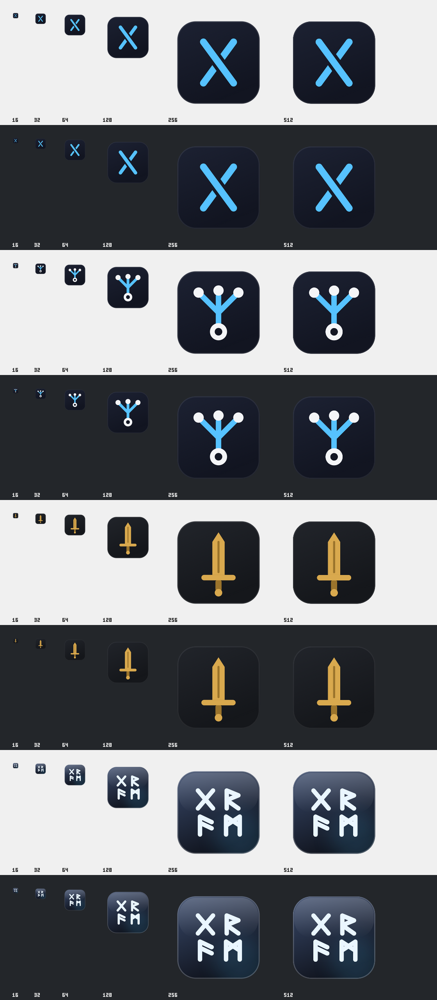

# Gram app icons

`app-icons/` holds the SVG masters for the four icons Settings → Appearance → App icon offers, in
`APP_ICONS` order (`packages/contracts/src/desktop-bridge.ts`):

| Id       | Name           | Notes                                                             |
| -------- | -------------- | ----------------------------------------------------------------- |
| `gift`   | Gift rune      | Default; the bundle icon. Elder Futhark G (gebo) drawn as a knot. |
| `fanout` | Fan-out        | One stem splitting into three: the orchestrator and its workers.  |
| `blade`  | Sword          | Gram, Sigurd's sword, in gold and charcoal.                       |
| `glass`  | Runes on glass | GRAM in four runes on a frosted tile.                             |

Each master is a 1024×1024 canvas with an 824px rounded tile and 100px of transparent padding, the
macOS icon grid. The palette is cyan `#56c2ff` on midnight `#1d2233`–`#121521`.

After the pinned frozen Bun install, run from the repository root (on Linux, under `xvfb-run -a`):

```sh
node_modules/.bin/install-electron
bun run --filter @gram/desktop generate:icon
```

Generation reuses pinned Electron: an offscreen window rasterises each SVG at 1024px and
`nativeImage` resamples it with `quality: "best"`, in a disposable profile. Node writes the PNG,
ICO and ICNS containers itself, so every platform produces the same files. The ICNS holds PNG
representations (`icp4`, `icp5`, `ic07`–`ic14`), the types `iconutil` writes for these sizes.

Outputs:

- `../build/icon.png`, `../build/icon.ico`, `../build/icon.icns`: the Gift rune, for Linux,
  Windows and macOS packaging.
- `../../web/public/favicon.ico`, `../../web/public/gram-icon.png`: the Gift rune for the browser.
- `../../web/public/app-icons/<id>.png`: every icon at 512px. Settings shows them, and the shell
  loads the chosen one from the packaged web root into the Dock (macOS) or every window's taskbar
  icon (Windows, Linux) at launch and on change. The choice is saved in `app-icon.json` in the
  app's user data folder.
- `gram-icon-preview.png`: a contact sheet of all four on light and dark, 16–256px at actual
  size and 512px at 50%.



A swapped icon applies only while Gram runs: Finder, Launchpad, the Start menu and installers keep
the bundled Gift rune, as macOS and Windows read it from the app itself.

macOS notifications use the bundle's icon as well. If they show an older icon than the Dock,
Notification Center's cache or an old copy of Gram is to blame, not the app.
