# Needs you home: handoff

[Brief](brief.md) · [Decisions](decisions.md) · [Approved page](v1.html)

## Target

`v1.html`, direction **C Hybrid**. The build must match these boards and states:

- **C Hybrid · popover** (full and empty):
  - the sidebar's needs-you pill, which ⌘⌥3 also opens;
  - rows grouped by workspace;
  - kind icons with hover text;
  - a quick answer on each row;
  - a footer with "N more · Later N" and See all.
- **C Hybrid · panel** (full and empty):
  - a docked right panel beside the thread;
  - its header holds the count, Later, the kind filter and Close;
  - rows grouped by workspace, with actions on hover or focus;
  - the Undo line;
  - the empty state.
- **B Jump · landed**, which C keeps: a pick opens the thread scrolled to the turn that asked.
  The next-needs-you stepper (⌘⇧U, ⌘⇧Y) moves through the list.

## Boards

The approved direction, C Hybrid:

| Dark                                                | Light                                                 |
| --------------------------------------------------- | ----------------------------------------------------- |
| 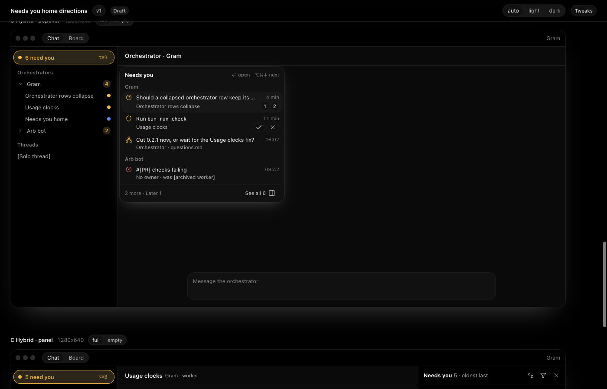 | 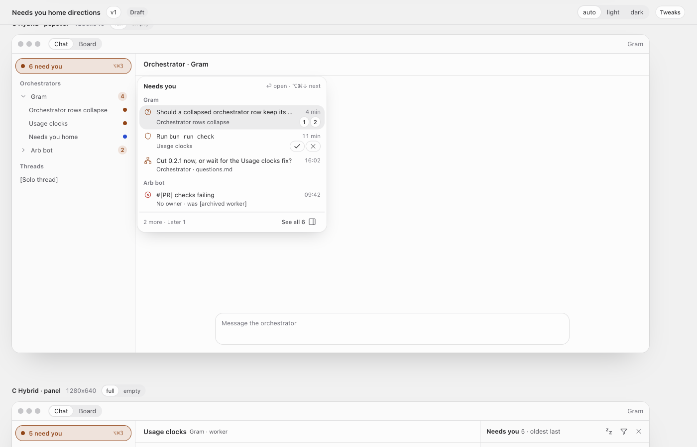 |
| 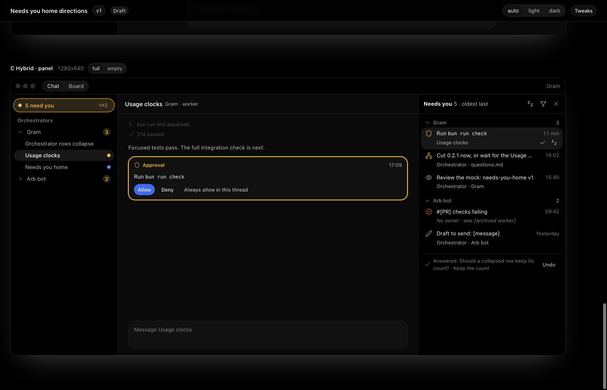     | 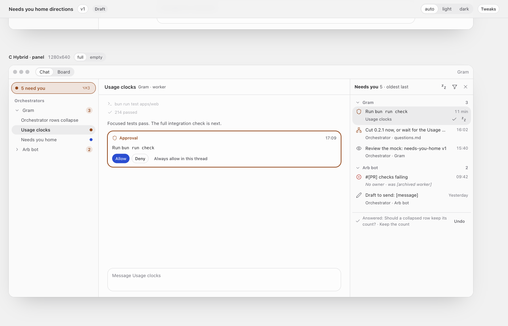     |
| 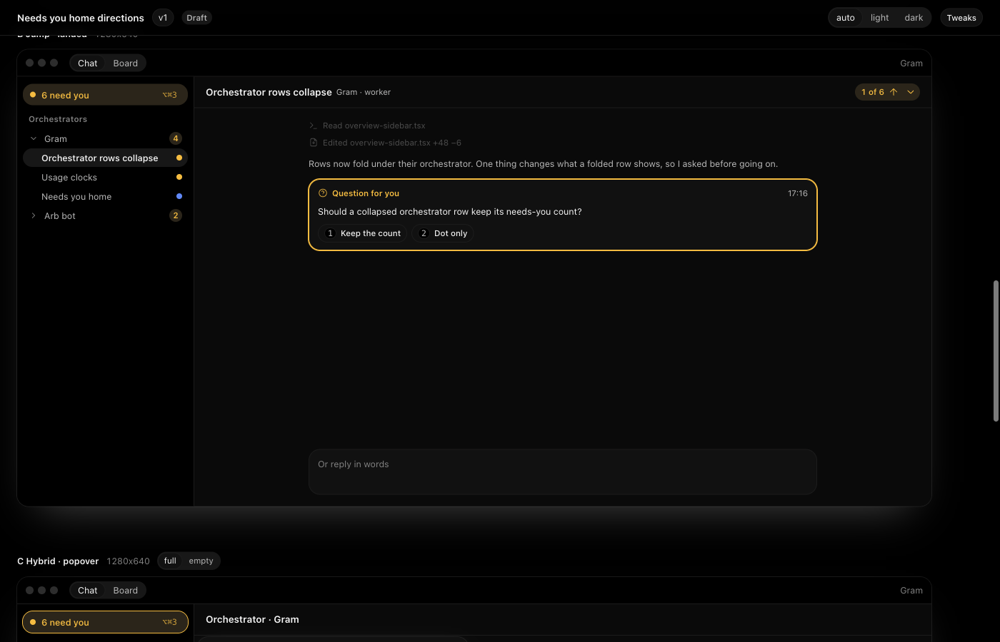     | 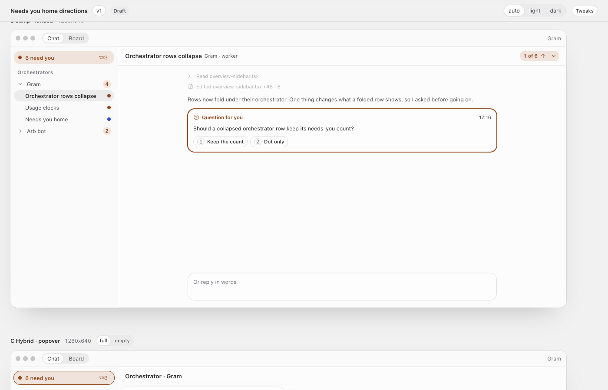     |

The panel's empty state:

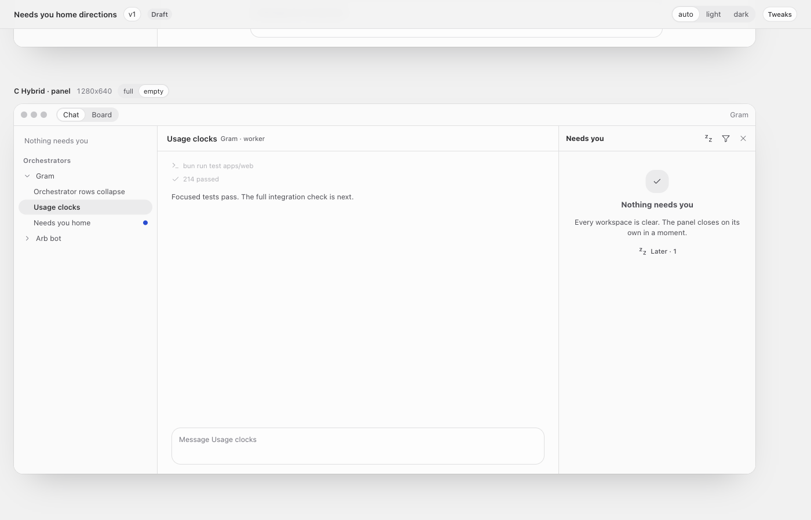

The dropped directions, kept because the review cards and their tests use them:

| Dark                                              | Light                                                     |
| ------------------------------------------------- | --------------------------------------------------------- |
| 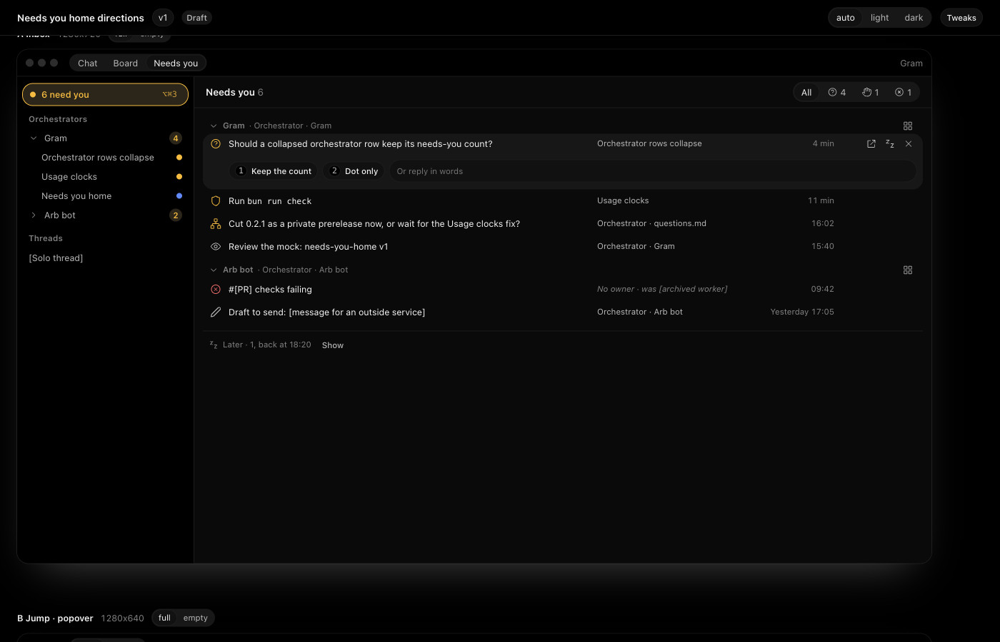          | 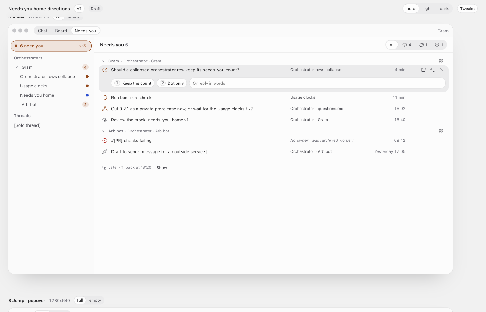                |
| 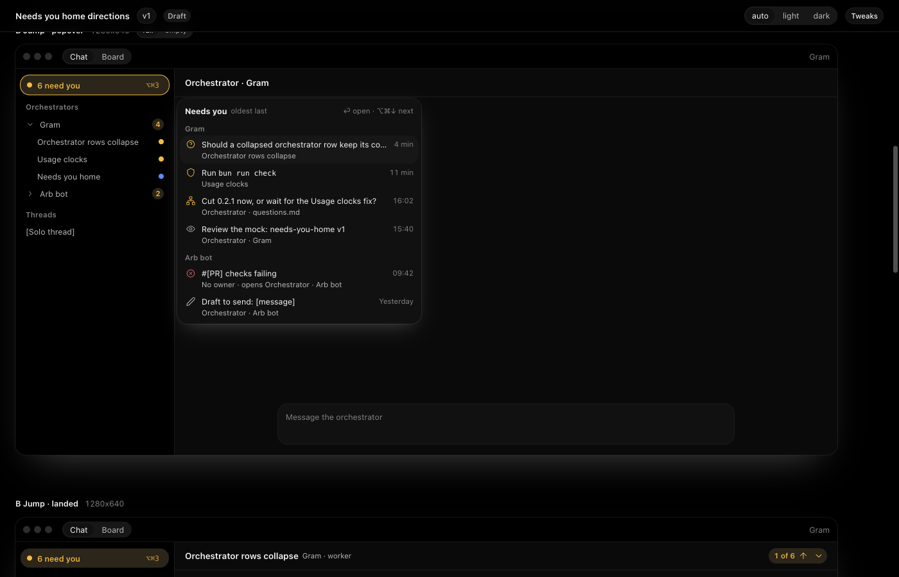 | 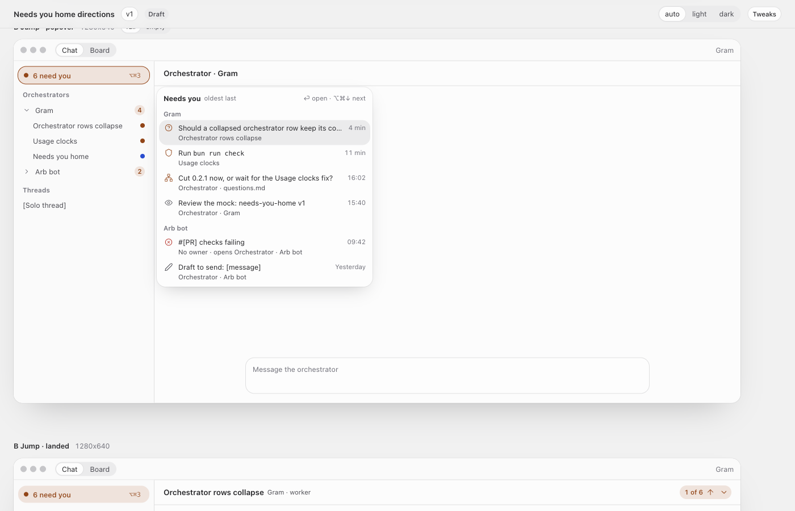       |
| 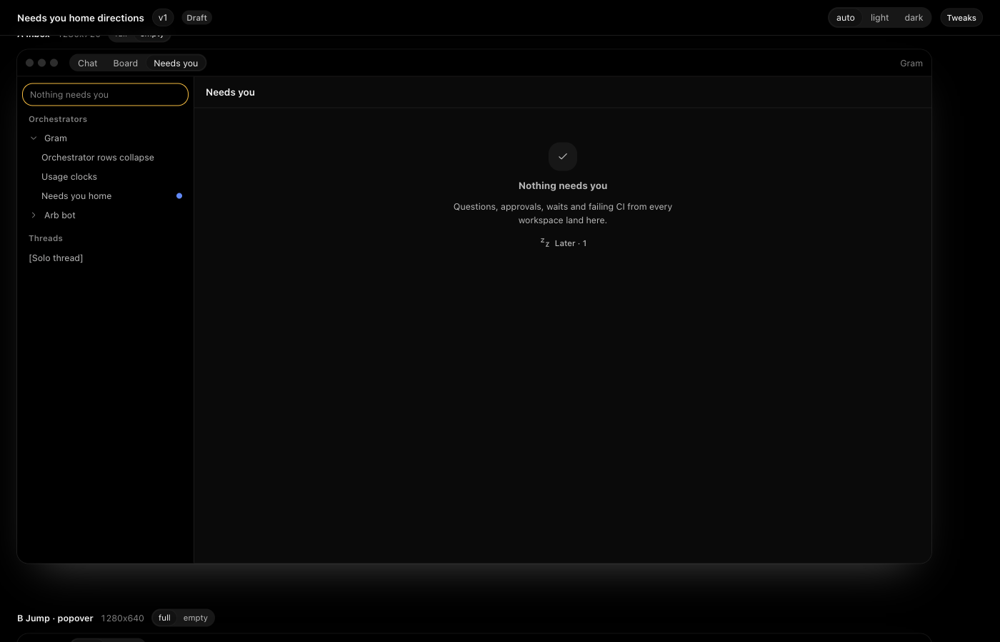   | 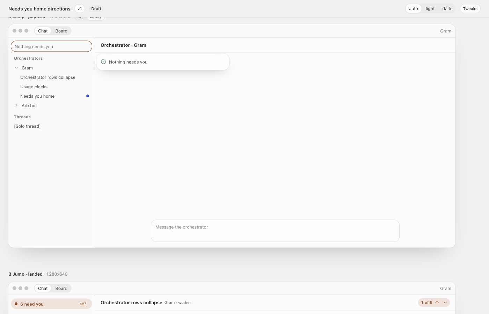 |

## Decisions

- C was picked. A Inbox and B Jump are dropped as separate directions.
- Later (one hour) and Dismiss are kept. Dismiss stays `settings.inbox.cleared`.
- Grouping is by workspace, then orchestrator, across every workspace.

## Parts

| Mock                     | Build                                                                          |
| ------------------------ | ------------------------------------------------------------------------------ |
| `.ny-pill`               | The overview's `NeedsYou` pill and the rail's pill, unchanged in look          |
| `.ny-pop` popover        | `components/ui/popover` anchored to the pill                                   |
| `.ny-panel`              | A new right-hand panel (new)                                                   |
| `.ny-row`, `.pop-row`    | New row component sharing the 28 px row shape (new)                            |
| `.btn.sm.icon` + `title` | `button` (`size="icon-xs"`) with `title`/`tooltip`                             |
| `.segmented` filter      | `button-group`                                                                 |
| Quick answers            | `holdAnswer` (`ask-answer.ts`) and the ask's own options; waits' `resolveWait` |
| `.ny-later`              | Undo line from `useAskStackStore`                                              |
| `.empty`                 | The app's empty pattern                                                        |
| `.ask-card.landed`       | `useRevealStore` flash on the target message                                   |

## Deviations allowed

- Real lengths of names and text, and real ages.
- Which quick answers a kind offers when the source has none: a free-form question opens its
  thread.
- Where the stepper's position shows.

These may not change without asking: the popover-then-panel structure, grouping by workspace,
and the states.

## Gaps

- `[PR]` and `[archived worker]` come from real failures.
- `[message]` comes from the wait's title.
- `[Solo thread]` comes from real threads.
